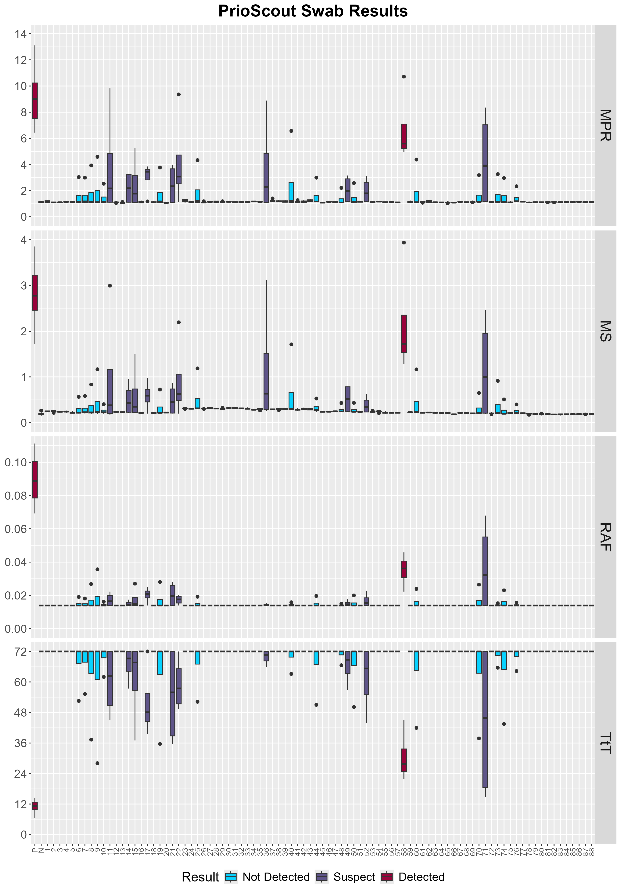
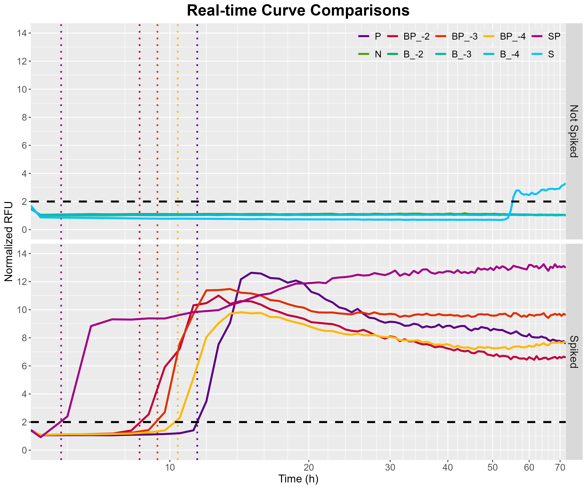

```{r, echo=FALSE, message=FALSE}
library(dplyr)
library(readxl)
library(stringr)
library(kableExtra)
```

# Canadian Reindeer PrioScout Swab Report

::: {.panel-tabset}

<!-- {width="100%"} -->

```{r Initialize, echo=FALSE, eval=TRUE}
calcs <- read.csv("data/calculations.csv", check.names = FALSE)
results <- read.csv("data/results.csv", check.names = FALSE)
salt_results <- read.csv("data/salt_summary.csv", check.names = FALSE)

sample_number <- nrow(filter(results, !(`Sample IDs` %in% c("N", "P"))))
positives <- results %>%
  filter(Result == "Detected" & `Sample IDs` != "P")
suspects <- results %>%
  filter(Result == "Suspect")
```

## Methodology

**All reactions were run for 72 hours at 42°C.**

### Sentinel Swabs
Swab pellets were resuspended in 500μL of 0.1% SDS/1X PBS. Samples were run by RT-QuIC in 4 replicates. Results were compared against the negative plate controls using a t-test with the alternative hypothesis being that a sample will have a larger value than the negative control. Metrics analyzed were maxpoint ratio (MPR) and maximum slope (MS). The p-values for each metric must have been ≤ 0.05 and at least 50% of replicates must have crossed a threshold of twice the background fluorescence for a sample to have been considered detected. If a sample had at least 50% of its replicates cross the threshold, but was negative for the other two metrics, it was labelled as "suspect".

### Salt block
The salt block was dissolved into a stock solution of 100mg/mL. The stock solution was then serially diluted 10-fold into 10^-2^--10^-4^ concentrations. The final concentration of the salt block in the reaction was 20ng/μL, 2ng/μL, and 0.2ng/μL. These concentrations were tested both alone and spiked with an equivalent 10^-3^ concentration of positive control lymph node.

Additionally, the salt block was swabbed directly and processed according to the current MNPRO environmental swab extraction SOP. Pellets from the extraction were resuspended in 500μL of SDS/PBS and tested either alone or spiked with positive control as above.

Results of the spiking were analyzed against the RAFs of a serial titration of positive control to determine the relative effect on the reaction kinetics. Non-spiked samples were observed for any spurious seeding activity.

\newpage

## Swab Results
-   Positives: **`{r} paste(positives[["Sample IDs"]], sep = ", ")`**
-   Suspects: **`{r} paste(suspects[["Sample IDs"]], sep = ", ")`**

```{r, echo=FALSE}
#| label: tbl-results
background_list <- list(
  "Detected" = "#99023B",
  "Suspect" = "#5F5589",
  "Not Detected" = ifelse(knitr::is_html_output(), "none", "white")
)

text_list <- list(
  "Detected" = "white",
  "Suspect" = "white",
  "Not Detected" = "black"
)

results %>%
  select(c(1, 11:15)) %>%
  filter(!(`Sample IDs` %in% c("N", "P"))) %>%
  rename_all(~ str_replace(., "_", " ")) %>%
  mutate_all(
    ~ cell_spec(
      .,
      background = background_list[Result],
      color = text_list[Result]
    )
  ) %>%
  kable(
    booktabs = TRUE,
    longtable = TRUE,
    linesep = "",
    format = ifelse(knitr::is_html_output(), "html", "latex"),
    escape = FALSE,
    align = "c",
    caption = "Results of RT-QuIC testing. Samples were given a result of 'Not Detected' or 'Detected' if it was positive for zero or all three metrics, respectively. If a sample was threshold positive (i.e. more than half of replicates crossed threshold) but was negative for either of the other two metrics, it was designated as 'Suspect'. crossed: fraction of replicates above threshold; thres pos: at least half of replicates crossed threshold?; MPR: maxpoint ratio; MS: max slope."
  ) %>%
  kable_styling(
    # full_width = TRUE,
    latex_options = c("hold_position")
  )
```



\newpage

## Salt Block Results
The dissolved salt solutions exhibited no false seeding activity within the 72 hour time frame; however, when the blocks were swabbed and processed, the insoluble pellet showed significant seeding activity around the 50 hour mark.

Interestingly, each method of spiking the salt concentrations showed an relative increase in the speed of the reaction with the insoluble pellet from the swab protocol essentially doubling the speed of the reaction.

This study concludes that the chosen salt block has a significant effect on the kinetics of the reaction. Although, at the concentrations expected from swabbing a sentinel and not the block directly, we likely would not see false seeding activity in the given time frame.

`\rule{\linewidth}{0.01cm}`{=tex}

```{r, echo=FALSE}
#| label: tbl-saltresults
samp_order <- c("N", "P", "BP", "B", "SP", "S")
salt_results %>%
  select(-Dilutions) %>%
  filter(pos_dilution >= -3 | is.na(pos_dilution)) %>%
  mutate(
    `Sample IDs` = factor(`Sample IDs`, levels = samp_order),
  ) %>%
  arrange(`Sample IDs`) %>%
  mutate_at(c("median_TtT", "median_RAF"), ~ signif(., 4)) %>%
  kable(
    booktabs = TRUE,
    longtable = TRUE,
    linesep = "",
    format = "html", # "latex",
    escape = FALSE,
    align = "c",
    caption = "Summary table of the salt block results. Kinetics were compared using time-to-threshold (TtT) and its inverse, rate of amyloid formation (RAF). Dilutions are represented in log form. pos_dilution: dilution factor of positive control; block_dilution: dilution factor of salt block; N: negative control; P: positive control; B: salt block; BP: salt block spiked with positive control; S: salt block swab; SP: salt block swab spiked with positive control."
  )
```



## Plate Views
```{r, echo=FALSE, fig.width=7, out.width="100%"}
files <- list.files("figures/plateviews", full.names = TRUE)
knitr::include_graphics(files)
```

:::


